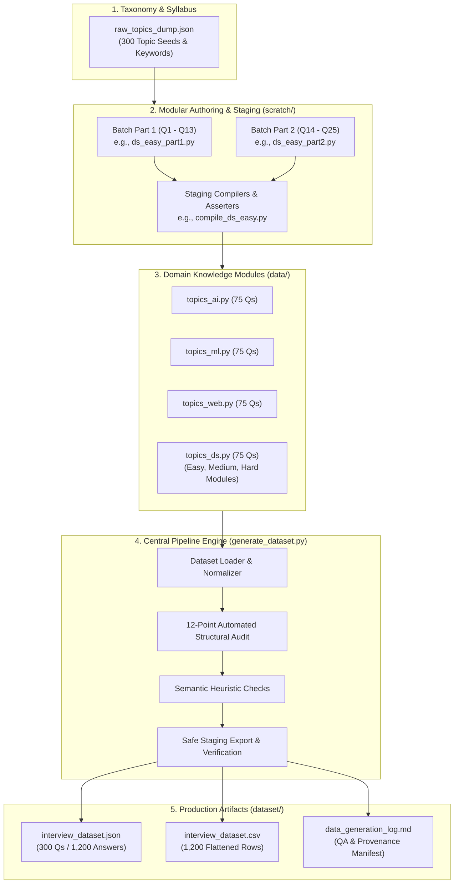

# AI Interview Evaluation System: Architecture, Evolution & Codebase Guide

## Executive Summary

The **AI Interview Evaluation System** is an end-to-end framework designed to automatically evaluate, critique, and score candidate technical interview responses across four core computing disciplines:
1. **Artificial Intelligence (AI)**
2. **Machine Learning (ML)**
3. **Web Development**
4. **Data Science**

Across three calibrated difficulty tiers (**easy**, **medium**, **hard**).

To develop and validate scoring models (such as Sentence-Transformers, LLM-as-a-judge prompts, concept coverage analyzers, or score regressors), an evaluation system requires a **structured, consistent reference dataset**. This repository provides that foundational dataset: **300 deeply technical questions** and **1,200 synthetic candidate responses** paired with explicit question-specific expected concepts, annotated missing concepts, and provisional score calibration targets.

---

## 1. Project Background & The Evolution Story

### The Core Problem: The Failure of "Mad-Libs" Templates
Early iterations and naive mock interview generators often rely on generic string templates and keyword substitution:
```python
# The Flawed "Mad-Libs" Pattern:
f"In {domain}, {topic} is a core concept that relies on {keywords[0]} and {keywords[1]}."
```
This pattern suffers from severe limitations:
- **Superficial & Inauthentic:** Model answers fail to explain actual architectural tradeoffs, computational complexities, or mathematical derivations.
- **Unrealistic Speech:** Candidate responses do not reflect authentic interview cadences, speech hesitation, varied depth of comprehension, or common real-world misconceptions.
- **Unreliable Annotations:** "Missing concepts" generated by randomly slicing keyword lists produce nonsensical evaluation targets (e.g., penalizing a candidate for omitting an indexing tag even when the underlying concept was thoroughly explained).

### The Solution: Modular High-Fidelity Authoring
We transitioned to a modular, programmatic compilation and validation pipeline:
1. **Explicit Conceptual Decomposition:** Separation of high-level indexing tags (`keywords`) from atomic, verifiable technical assertions (`expected_concepts`). No question falls back to generic placeholders like `"Understanding of X"`.
2. **Realistic Spoken Transcripts:** Sample answers were authored to simulate automatic speech recognition (ASR) transcripts across four quality tiers (`excellent`, `good`, `average`, `poor`), incorporating spoken phrasing, filler words, and varied levels of technical depth.
3. **Ground-Truth Missing Concept Alignment:** Every missing concept must strictly belong to the question's `expected_concepts`. An answer's missing concepts reflect its actual content rather than an arbitrary requirement forced by its quality label.
4. **Automated 12-Point Structural Verification:** A comprehensive audit suite that guarantees 100% structural and relational integrity before artifacts are exported.

---

## 2. System Architecture



---

## 3. Directory Structure & File Catalog

```
AI Interview Evaluation system/
├── PROJECT_OVERVIEW.md             # Complete architecture and provenance documentation (this file)
├── generate_dataset.py             # Central compilation, validation, and export pipeline
├── evaluate_answer.py              # Modular answer-evaluation engine (similarity + concept coverage)
├── raw_topics_dump.json            # Seed question & keyword taxonomy blueprint
│
├── data/                           # Verified production domain topic modules
│   ├── topics_ai.py                # 75 AI questions (25 easy, 25 medium, 25 hard)
│   ├── topics_ml.py                # 75 ML questions (25 easy, 25 medium, 25 hard)
│   ├── topics_web.py               # 75 Web Dev questions (25 easy, 25 medium, 25 hard)
│   ├── topics_ds.py                # Data Science module aggregator
│   ├── topics_ds_easy.py           # 25 Data Science easy questions
│   ├── topics_ds_medium.py         # 25 Data Science medium questions
│   └── topics_ds_hard.py           # 25 Data Science hard questions
│
├── dataset/                        # Production deliverables (promoted after staging verification)
│   ├── interview_dataset.json      # Structured JSON benchmark
│   ├── interview_dataset.csv       # Flattened CSV for ML training & analysis
│   └── data_generation_log.md      # Automated QA verification & provenance report
│
├── scratch/                        # Modular staging workspace and compilation archives
│   ├── staging_dataset/            # Intermediate export directory for safe pre-promotion audit
│   ├── ai_easy_part1.py ...        # Staged question batches
│   └── compile_ds_easy.py ...      # Staging assertion scripts
│
├── scratch.zip                     # Archive backup of staging scripts
└── data.zip                        # Archive backup of domain modules
```

---

## 4. File-by-File Technical Breakdown

### Core Pipeline & Blueprints

#### 1. `generate_dataset.py`
The master execution pipeline. It provides:
- **Deterministic Loading:** Imports topic arrays directly from version-controlled Python modules in `data/`. No pseudorandom generation is used (the previously unused `--seed` option has been removed).
- **Schema Normalization:** Formats deterministic IDs (`q_<domain>_<level>_<idx>`), standardizes depth expectations, and indexes sample answer identifiers (`<qid>_s1` through `<qid>_s4`).
- **12-Point Automated Structural Audit (`validate_structural`):** Halts pipeline execution if any structural, numerical, or conceptual inconsistency is detected.
- **Semantic Heuristic Audit (`validate_semantic`):** Analyzes answer lengths and vocabulary divergence while explicitly separating automated heuristics from human/SME verification.
- **Safe Staging & Consistency Verification:** Exports all artifacts to `scratch/staging_dataset/` first, verifies byte-for-byte and cell-for-cell consistency between JSON and CSV, and promotes to `dataset/` only after all tests pass.

#### 2. `evaluate_answer.py`
The standalone evaluation module. It accepts a question, reference model answer, expected concepts, and a candidate response, producing:
- Semantic similarity via Sentence-Transformers (`all-MiniLM-L6-v2` or `all-mpnet-base-v2`).
- Concept coverage identifying which `expected_concepts` were addressed and which appear missing.
- Configurable scoring weights combining semantic similarity and conceptual coverage.
- Detailed, human-readable explanations of scoring decisions.

#### 3. `raw_topics_dump.json`
The original syllabus blueprint containing 300 topics mapped to formal questions and reference keywords across all four domains.

---

### Domain Data Modules (`data/`)

Each domain module encapsulates 75 deep-dive questions structured into 25 easy, 25 medium, and 25 hard tiers:

* **`data/topics_ai.py`**:
  - *Easy:* Graph traversal (BFS vs DFS), A* search admissibility, Expert Systems architecture, Fuzzy vs Crisp logic, Minimax algorithm, Alpha-Beta pruning, Constraint Satisfaction Problems (CSPs).
  - *Medium:* Genetic algorithms, Forward vs Backward chaining, Dempster-Shafer theory, Monte Carlo Tree Search (MCTS), Markov Decision Processes (MDPs), Knowledge Graph embeddings.
  - *Hard:* Bellman optimality equations, Partially Observable MDPs (POMDPs), Multi-Agent Reinforcement Learning (MARL), Automated Theorem Proving, Normalized Graph Laplacians & Spectral Clustering.

* **`data/topics_ml.py`**:
  - *Easy:* Supervised vs Unsupervised vs Reinforcement learning, Bias-Variance tradeoff, Overfitting/Underfitting, L1 (Lasso) vs L2 (Ridge) regularization, Precision/Recall/F1, Decision Trees.
  - *Medium:* SVM dual formulation & kernel trick, Random Forest bagging vs Gradient Boosting, CNN convolution mechanics, Backpropagation mathematics, Cross-Entropy vs MSE.
  - *Hard:* Transformer Multi-Head Self-Attention derivations, GAN minimax games, Diffusion reverse-time SDEs, Contrastive representation learning (SimCLR), FlashAttention GPU memory optimization.

* **`data/topics_web.py`**:
  - *Easy:* HTTP vs HTTPS (TLS handshake), REST architectural principles, CSS Box Model, JavaScript event loop & task queues, Cookies vs LocalStorage, Semantic HTML.
  - *Medium:* React Virtual DOM reconciliation, CORS preflight mechanics, WebSockets vs Server-Sent Events (SSE), SQL Indexing (B-Trees), JWT vs Session cookies, SSR vs SSG vs ISR.
  - *Hard:* Micro-frontend architecture, Distributed database sharding & consensus (Raft/Paxos), Zero-Downtime deployment strategies, CDN edge caching & stale-while-revalidate, OAuth 2.0 PKCE flow.

* **`data/topics_ds.py` (and `topics_ds_*.py`)**:
  - *Easy:* Mean vs Median under skewness, Central Limit Theorem, P-value interpretation, SQL JOIN mechanics, Missing value imputation strategies, Correlation vs Causation.
  - *Medium:* Type I vs Type II errors and statistical power, A/B testing sample size calculation, Dimensionality reduction via PCA, Time series stationarity (ADF test, ARIMA), SMOTE for class imbalance.
  - *Hard:* Causal Inference (Propensity Score Matching, Difference-in-Differences), Bayesian A/B testing (Beta-Binomial conjugate priors), Feature store architectures, Temporal Fusion Transformers (TFT), Survival analysis (Cox Proportional Hazards).

---

## 5. Automated Quality Assurance & Verification Matrix

The pipeline enforces a 12-point structural audit prior to promoting data to production:

| # | Structural Audit Criterion | Benchmark Standard | Result | Status |
| :-: | :--- | :--- | :-: | :-: |
| **1** | **Required Fields Completeness** | 0 missing fields across all Qs & SAs | `0 missing` | **PASSED** |
| **2** | **Unique Question IDs** | Exactly 300 unique IDs (`q_<domain>_<level>_<idx>`) | `300 unique` | **PASSED** |
| **3** | **Unique Question Texts** | Exactly 300 unique question prompts | `300 unique` | **PASSED** |
| **4** | **Valid Domain & Level Values** | 4 valid domains, 3 valid levels | `0 invalid` | **PASSED** |
| **5** | **Balanced Cell Distribution** | Exactly 25 per cell (12 cells = 300 total) | `25 / cell` | **PASSED** |
| **6** | **Sample Answer Count** | Exactly 4 sample answers per question | `1,200 total` | **PASSED** |
| **7** | **Unique Sample IDs** | Exactly 1,200 unique IDs (`<qid>_s1` .. `<qid>_s4`) | `1,200 unique` | **PASSED** |
| **8** | **Non-Empty Text Content** | 0 empty question, model answer, or answer texts | `0 empty` | **PASSED** |
| **9** | **Score Value Bounds** | All scores strictly satisfy $0 \le \text{score} \le 100$ | `0 invalid` | **PASSED** |
| **10**| **Score-Band Alignment** | 100% adherence to quality score ranges | `0 mismatches` | **PASSED** |
| **11**| **Export Format Consistency** | JSON and CSV 100% equivalent post-export | `0 discrepancies` | **PASSED** |
| **12**| **Concept Structure Integrity** | All missing concepts strictly exist in expected concepts | `0 violations` | **PASSED** |

### Score Band Alignment Rules
- **`excellent`**: 90 – 100
- **`good`**: 70 – 89
- **`average`**: 50 – 69
- **`poor`**: 0 – 49

---

## 6. Honest Provenance & Limitations Disclosure

To maintain scientific integrity and realistic expectations:
1. **Synthetic Nature of Answers:** Candidate responses are synthetically authored spoken transcripts designed to simulate spoken hesitations, colloquial filler words, and conceptual misunderstandings. They are **not** live recordings of human job applicants.
2. **Synthetic Score Targets:** The numerical scores are calibration targets designed for benchmarking automated evaluators. They do **not** originate from empirical grading panels of human interviewers.
3. **Automated vs. Human Verification:**
   - **Automated Structural Checks:** 100% verified (field presence, uniqueness, score boundaries, export consistency, concept schema membership).
   - **Human SME Review:** Formal human subject-matter expert review of nuanced mathematical proofs, edge cases, and subjective scoring calibration remains a recommended step before high-stakes certification deployment.

---

## 7. Next Steps: Implementing the Answer-Evaluation Engine

With the benchmark dataset compiled, validated, and safely archived:
1. **Answer Evaluation Engine (`evaluate_answer.py`):** Test embedding-based semantic similarity and concept coverage scoring against the 1,200 sample answers.
2. **Configurable Weight Tuning:** Calibrate the relative weights between semantic similarity and concept coverage against the provisional score bands.
3. **Natural Language Inference (NLI) Coverage:** Integrate a cross-encoder NLI model (e.g. `DeBERTa-v3-large-MNLI`) to evaluate concept entailment instead of pure cosine distance.
4. **Interactive Mock Interview Interface:** Build a lightweight CLI or web application for candidate interaction.
